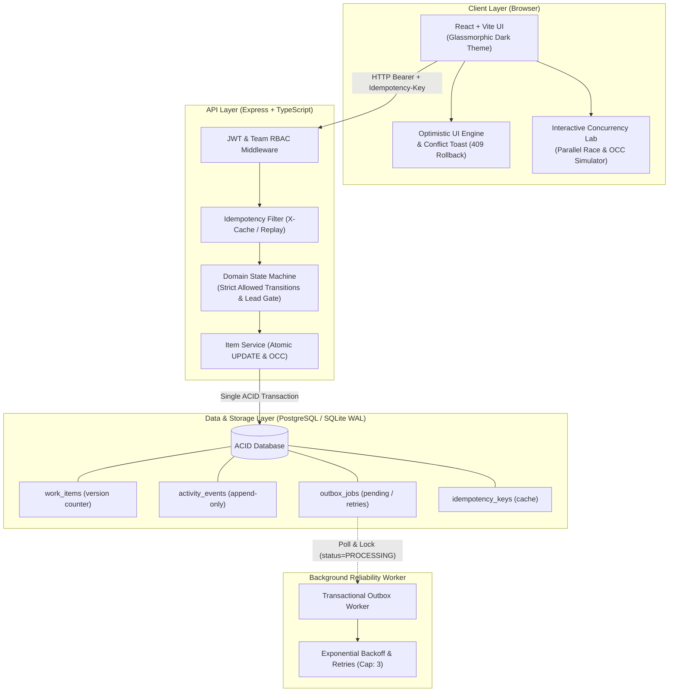

# Newtonite Operations Under Pressure

> **Operations Under Pressure** is an internal operational platform engineered for cross-functional teams to reliably triage, assign, track, and resolve critical incidents, payment investigations, and compliance requests. Designed specifically to withstand high concurrency and prevent human collision, it features atomic conditional claims, optimistic concurrency control (OCC), idempotent mutation requests, resource-level RBAC, and reliable asynchronous job execution via the Transactional Outbox Pattern.

---

## Architecture Overview



---

## Critical Behaviors Beyond CRUD

Newtonite implements all core reliability and concurrency protections mandated in the challenge brief, backed by full automated test suites:

| Critical Behavior | Engineering Mechanism | Automated Test |
| :--- | :--- | :--- |
| **1. Concurrent Claims** | Atomic conditional update: `UPDATE work_items SET assignee_id = ? WHERE id = ? AND assignee_id IS NULL`. Zero rows updated throws `HTTP 409 Conflict`. | `tests/concurrency.test.ts` (Fires two simultaneous claims via `Promise.all`; exactly one succeeds, other gets 409). |
| **2. Stale Update (OCC)** | Optimistic Concurrency Control with integer `version`. Updates check `WHERE version = ?` and increment. Version mismatch returns `HTTP 409` with latest database record for reconciliation. | `tests/stale-update.test.ts` (Submitting outdated version is rejected and underlying data remains unchanged). |
| **3. Repeated Requests** | `Idempotency-Key` header cached in `idempotency_keys` table. Duplicate submissions replay the stored status code and response payload with header `X-Idempotency-Replay: true`. | `tests/idempotency.test.ts` (Exact duplicate requests produce single database row and identical response). |
| **4. Workflow Transitions** | Strict domain state machine (`OPEN -> IN_PROGRESS -> AWAITING_APPROVAL -> RESOLVED -> CLOSED`). Transitions from `AWAITING_APPROVAL` to `RESOLVED` strictly require `LEAD` or `ADMIN` role in that item's team. | `tests/workflow.test.ts` (Illegal state jumps return 400 Bad Request; non-lead approval attempts return 403 Forbidden). |
| **5. Resource-Level RBAC** | Multi-tenant team isolation. Every query and mutation is scoped to user's team memberships (`VIEWER`, `MEMBER`, `LEAD`, `ADMIN`). Cross-team access returns `403 Forbidden`. | `tests/authorization.test.ts` (Unauthorized team access rejected; Viewer cannot mutate; Admin can access all). |
| **6. Reliable Async Work** | **Transactional Outbox Pattern**: Job rows written inside the same database transaction. Background worker executes jobs with exponential backoff (`2^attempts * 1s`) and capped retries. | `tests/outbox.test.ts` (Guarantees atomic outbox row creation and verifies dead-letter transition on failure). |
| **7. Immutable Audit Trail** | Every mutation atomically logs an append-only event in `activity_events` inside the exact same database transaction. Item history can never disagree with current state. | Verified across all test suites. |
| **8. Scale Awareness** | Keyset / Cursor-based pagination (`created_at`, `id`) and compound B-tree indexes prevent degradation on large datasets. | Tested in list queries and dashboard views. |

---

## Quick Start & Running the Project

### Prerequisites
- **Node.js** (v20+ or v24+ recommended) and **npm**
- *(Optional)* **Docker** and **Docker Compose**

---

### Option 1: One-Command Startup (Local Development)

The project includes an embedded, high-performance SQLite WAL database engine and automatically initializes the schema and seeds demo data on initial launch:

```bash
# 1. Install dependencies
npm install
npm run --prefix frontend install

# 2. Build frontend client
npm run build:frontend

# 3. Start Newtonite Ops (Serves full API & UI on port 3000)
npm start
```

Open your browser at **[http://localhost:3000](http://localhost:3000)**.

> **Zero Configuration:** Database migrations and demo users, teams, and items are seeded automatically on first run.

---

### Option 2: Docker Compose (PostgreSQL + Node.js)

To run the application with a dedicated PostgreSQL database container:

```bash
docker compose up --build
```

- App UI & API: **[http://localhost:3000](http://localhost:3000)**
- PostgreSQL Database: `localhost:5432` (`newtonite_ops`)

---

## Running Automated Tests

Run the full automated test suite covering all 6 critical behaviors with one single command:

```bash
npm test
```

### Running in Watch Mode
```bash
npm run test:watch
```

---

## Demo Personas & Credentials

The database comes pre-seeded with 10 users across 4 teams (`Core Engineering`, `Payments & Risk`, `Legal & Compliance`, `Customer Operations`).

> **Tip:** You can switch between any of these users instantly using the **Evaluator Persona Switcher** dropdown in the top-right corner of the web interface!

All accounts use the default password: `password123`

| User Name | Email | Team | Role | Capabilities |
| :--- | :--- | :--- | :--- | :--- |
| **Alice Admin** | `admin@newtonite.internal` | All Teams | **ADMIN** | Global superuser; bypasses team constraints |
| **Elena Vance** | `lead.eng@newtonite.internal` | Core Engineering | **LEAD** | Full mutation + approves awaiting approval items |
| **Dave Miller** | `dev.eng@newtonite.internal` | Core Engineering | **MEMBER** | Creates, claims, edits, and transitions work items |
| **Victor Vance** | `viewer.eng@newtonite.internal` | Core Engineering | **VIEWER** | Read-only access to engineering work items & history |
| **Priya Patel** | `lead.pay@newtonite.internal` | Payments & Risk | **LEAD** | Team lead for payments and chargeback triage |
| **Omar Farooq** | `ops.pay@newtonite.internal` | Payments & Risk | **MEMBER** | Payments investigator |
| **Claire Dupont** | `lead.comp@newtonite.internal` | Legal & Compliance | **LEAD** | Compliance officer |
| **Arthur Dent** | `auditor.comp@newtonite.internal` | Legal & Compliance | **MEMBER** | Compliance auditor |
| **Sarah Jenkins** | `lead.ops@newtonite.internal` | Customer Operations | **LEAD** | Customer support lead |
| **Chris Cross** | `cross.team@newtonite.internal` | Eng & Ops | **MEMBER & LEAD** | Multi-team user (Member in Eng, Lead in Ops) |

---

## Interactive Concurrency Lab

Click the **⚡ Concurrency Lab** button in the top navigation bar to test critical edge cases live in the browser:
1. **Parallel Claim Race:** Dispatches two simultaneous `HTTP POST /claim` requests via `Promise.all` from two team members to prove that exactly one succeeds and the other gets an atomic `409 Conflict`.
2. **Stale OCC Edit:** Sends an update with an outdated version tag (`v0`) to demonstrate graceful rejection and rollback.
3. **Idempotency Replay:** Sends duplicate requests with identical `Idempotency-Key` headers to observe cached execution (`X-Idempotency-Replay: true`).

---

## Known Limitations

1. **Short Polling instead of WebSockets:** The UI polls the Outbox and item stats every 5 seconds. In high-frequency collaborative environments with hundreds of concurrent editors, WebSockets or Server-Sent Events (SSE) would provide lower notification latency.
2. **In-Database Outbox Table at Scale:** For extreme write volumes (>50,000 events/sec), polling an RDBMS outbox table introduces disk I/O contention. At that scale, WAL log tailing (e.g. Debezium / Kafka Connect) is preferred.
3. **Ephemeral Token Storage:** Demo tokens are stored in `localStorage` for evaluation convenience. In production, HTTP-only SameSite cookies are recommended.

---

## Next Week I Would...

If given an additional sprint, the immediate priorities would be:
1. **Change Data Capture (CDC) via Debezium:** Stream outbox changes directly from PostgreSQL WAL logs into Apache Kafka for zero-poll async processing.
2. **Server-Sent Events (SSE) Channel:** Stream live conflict alerts directly to the user's browser when another teammate begins editing an item.
3. **Partitioning the `activity_events` Table:** Introduce monthly PostgreSQL range partitioning on `activity_events(created_at)` to preserve query performance over years of operation.
4. **Custom Role Definitions:** Allow team leads to define bespoke role permission matrices (e.g., custom triage permissions for contract workers).
